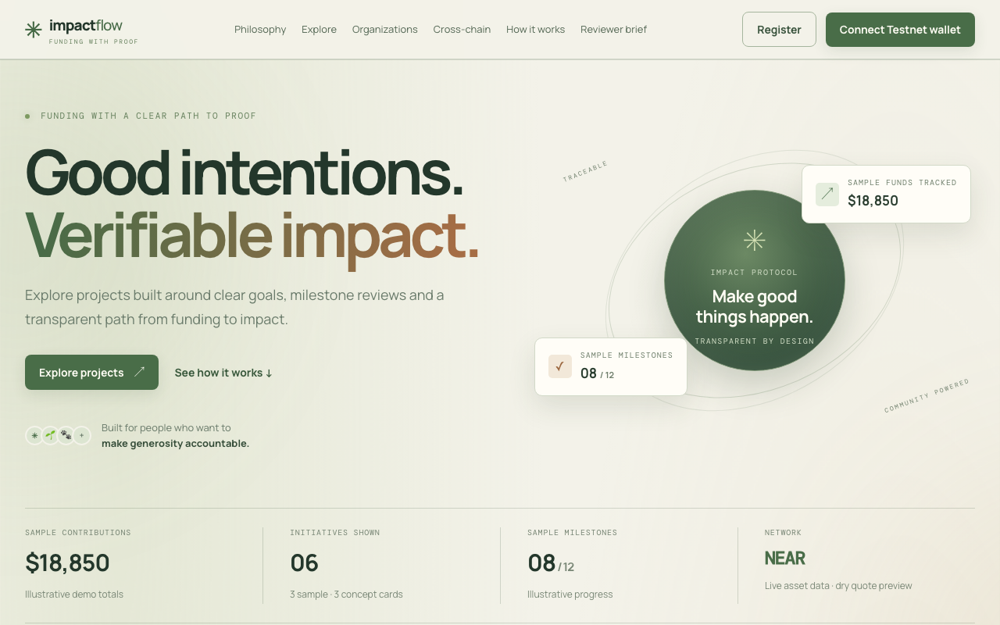
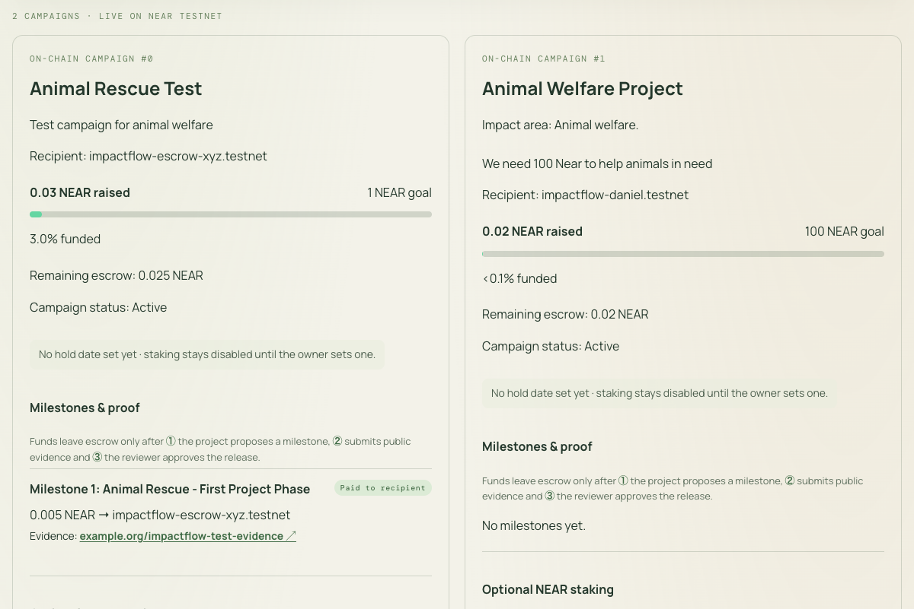
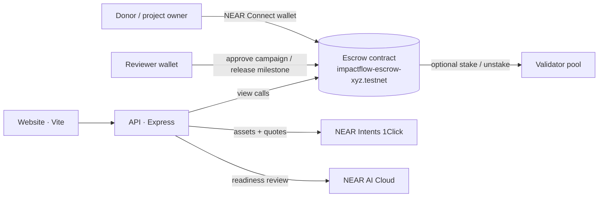

# ImpactFlow — funding with proof

**Donations for public-benefit projects shouldn't disappear into a black box.** ImpactFlow holds donations in a NEAR smart-contract escrow and releases them milestone by milestone. A project submits evidence, a reviewer approves it, and only then does the money move. Every step is an on-chain transaction anyone can check.

Built at **NEAR HACKATHON** · Tracks: **08 — Real-World Money** (primary), **13 — Open Innovation**



## Verified on NEAR Testnet

The escrow contract [`impactflow-escrow-xyz.testnet`](https://testnet.nearblocks.io/address/impactflow-escrow-xyz.testnet) has completed the full funding cycle on-chain:

| Step | Who signs | Transaction |
|---|---|---|
| 1. Create campaign | Project owner | [`Aw1hEF…`](https://testnet.nearblocks.io/txns/Aw1hEFnSKodjYBZVU3tNE8EEYGHb8G6rKqtUqwh2gDt5) |
| 2. Approve campaign | Reviewer | [`9EJWcc…`](https://testnet.nearblocks.io/txns/9EJWccZ4fjcBpMJg3tCQvbMaMzod6JZRdxWomgqiQL56) |
| 3. Donate 0.01 NEAR into escrow | Donor | [`CpEdDs…`](https://testnet.nearblocks.io/txns/CpEdDspHcXWqD4pihxMB8xABMAjGcEYrbVFynhVATouC) |
| 4. Propose milestone | Project owner | [`22zdjq…`](https://testnet.nearblocks.io/txns/22zdjqh5VveNad8384zfmQNZ6Y79N6p8wz7X2kTWxGu4) |
| 5. Submit milestone evidence | Project owner | [`y37BpP…`](https://testnet.nearblocks.io/txns/y37BpPzz6ckH9wAfkM6C6gTHT1cGQp7hmkimeZeJhTm) |
| 6. **Approve and release payout** | Reviewer | [`4cHHMk…`](https://testnet.nearblocks.io/txns/4cHHMkS8WauiwEX5Tsv26y9frNgq3Uhy3Lkruq3ZTzaT) |
| Wallet-signed campaign + donations from a separate user account | `impactflow-daniel.testnet` | [`DVnp9B…`](https://testnet.nearblocks.io/txns/DVnp9BSFmFf6KqCnrgKCW8shTeDjFoGbejbxyYajUeMu), [`EUgDNS…`](https://testnet.nearblocks.io/txns/EUgDNS6P1fyLbduWN2XiTiUwuMBAfDtEjse5sWFWuteC) |
| Upgrade to v2 (ongoing funds) + state-preserving migration | Contract / reviewer | [`5RtMdN…`](https://testnet.nearblocks.io/txns/5RtMdNWrsEk6LqxtN74raMkJiPwQR2HCLWWPCEspGSpT), [`3dTZFF…`](https://testnet.nearblocks.io/txns/3dTZFFnTPNLKWyiQbs5qStL9cb1HezjrydanfJD6hBPs) |
| Upgrade to v3 (campaign hold dates) + state-preserving migration | Contract / reviewer | [`9dYo1D…`](https://testnet.nearblocks.io/txns/9dYo1DbiFxuZPWTmaH1YUUqccmJBuUEG8QivRKkyPRdW), [`HiCh4n…`](https://testnet.nearblocks.io/txns/HiCh4nkPasWq5zzRtfmHwmhgzMvaU273dvtohGSxExcE) |
| Security hardening: storage deposit for new campaigns, milestone cap (code-only) | Contract | [`rMR4mW…`](https://testnet.nearblocks.io/txns/rMR4mWUopMhzErJ7EdGhg8LhKFf2CeiLQiSYvqu4YP7) |

**The deployed code is the code in this repo.** The on-chain code hash `8wqUojNLmRQcWiYGsvr2hWYsvBU9Ytfxk9beB7Akdrym` matches a release build of [`contract/src/lib.rs`](contract/src/lib.rs). [Reproduce it below](#verify-the-deployed-contract).



## What ImpactFlow does

| | Feature | NEAR technology |
|---|---|---|
| 🔒 | **Milestone escrow.** Donations are locked in the contract. Payouts need reviewer approval of submitted evidence. Staked principal can never be paid out early. | Rust smart contract (`near-sdk`), 34 unit tests |
| 🧾 | **Proof workflow in the app.** Project owners propose milestones and submit public evidence links; the reviewer sees an **Approve & release** button. Each step is a wallet-signed transaction. | Contract calls via NEAR Connect |
| 📜 | **Live on-chain ledger.** The transparency section lists the escrow's latest donations, evidence submissions and payouts, each linked to its transaction. | NearBlocks indexer + NEAR RPC |
| 👛 | **Wallet-signed actions.** Create campaigns, approve them and donate straight from the browser. | HOT Labs NEAR Connect |
| 🌐 | **Cross-chain support.** Donors can pay from many chains: live asset list (200+ assets) and dry quote previews before any funds move. | NEAR Intents 1Click API |
| 🕶️ | **Optional confidential routing.** Privacy modes are sent with quotes; sign-in uses a NEP-413 signed message. | NEAR Intents, NEP-413 |
| 🌱 | **Optional staking, bounded by a hold date.** Funded campaigns can stake idle escrow with an approved validator; rewards flow back to the same campaign. Every campaign commits to a **hold date**: donations close then, staking is only allowed while 3+ days remain to unstake, and in that final window **anyone** can force the unstake, so donations are never staked indefinitely. | NEAR native staking pools |
| 🤖 | **Project Readiness Agent.** Gives submitters structured feedback on clarity and completeness before review. It advises; it never approves or releases funds. | NEAR AI Cloud |
| 🏛️ | **Organization onboarding.** NGOs, companies and community groups register, create a profile and submit projects for review. | Local API |

## Run it locally (2 minutes)

Requirements: Node.js 18+ and internet access (for live NEAR Intents and Testnet data).

```bash
npm ci
npm run dev:all
```

Open <http://localhost:5173>. `dev:all` starts the API on port 8787 and the website on port 5173; press **Ctrl+C** to stop both. No `.env` is needed for the demo. Optional settings are listed in [`.env.example`](.env.example).

## Demo walkthrough for judges

1. **Escrow (Explore section).** The two campaign cards are read live from the Testnet contract. Campaign #0 shows a milestone with status `paid`, the result of the payout transaction above.
2. **Donate.** Select **Connect Testnet wallet**, then **Donate 0.01 NEAR** on an active campaign. The raised total updates from the contract.
3. **Create a campaign.** Fill in **Create a testnet campaign**. It stays inactive until the reviewer account approves it.
4. **Proof flow.** As the campaign owner, use **Propose milestone on-chain**, then paste a public HTTPS link and select **Submit evidence on-chain**. Connected as the reviewer, the milestone shows **Approve & release**, which pays the fixed recipient from escrow.
5. **Live ledger.** In **See where every token goes**, every row is a real escrow transaction; click one to open it on NearBlocks.
6. **Cross-chain.** Open **Cross-chain** and wait for the asset list. Pick two assets, enter recipient and refund addresses, then select **Get live quote preview**. This is a dry run, so no funds move.
7. **Organizations.** Select **Register**, create an account and organization profile, and submit a project. It appears as `pending_review`.
8. **Reviewer brief.** The last section and [`public/impactflow-evidence.json`](public/impactflow-evidence.json) list every capability with its status and limits.

## Architecture



| Path | Purpose |
|---|---|
| [`contract/src/lib.rs`](contract/src/lib.rs) | Escrow contract: campaigns, donations, milestones, reviewer release, staking |
| [`app.js`](app.js) | UI, wallet connection, escrow actions, 1Click quote flow |
| [`server/index.js`](server/index.js) | Accounts and projects API, NEAR Intents proxy, Testnet view calls (FastNEAR RPC with fallback, short cache), activity feed, AI agent |
| [`near-intents-auth.js`](near-intents-auth.js) | NEP-413 nonce and signature encoding |
| [`docs/`](docs) | Escrow design, security notes, Testnet checklist |

The API never holds user funds or signs transactions. Every transfer is approved by the user in their own wallet.

## Tests

```bash
npm run check && npm test && npm run build
cd contract && cargo test
```

The tests cover 6 web/API cases and 34 contract cases, and GitHub Actions runs both suites on every push.

### Verify the deployed contract

```bash
cd contract
RUSTFLAGS='-C link-arg=-s --cfg near' cargo build --target wasm32-unknown-unknown --profile release --locked
python3 -c "import hashlib,sys;d=hashlib.sha256(open('target/wasm32-unknown-unknown/release/impactflow_escrow.wasm','rb').read()).digest();a='123456789ABCDEFGHJKLMNPQRSTUVWXYZabcdefghijkmnopqrstuvwxyz';n=int.from_bytes(d,'big');s='';exec('while n:\n n,r=divmod(n,58);s=a[r]+s');print(s)"
```

Compare the output with the `code_hash` from the [`view_account` RPC call](https://docs.near.org/api/rpc/contracts#view-account) for `impactflow-escrow-xyz.testnet`.

## Honest status

ImpactFlow is a hackathon prototype on **Testnet**, not production donation infrastructure.

- **Not audited.** The contract has no independent audit and no refund flow, NEP-141 token escrow or multisig review yet.
- **Evidence isn't verified.** Milestone evidence is a submitted link. The contract enforces the approval process, not the real-world truth of the evidence.
- **Staking isn't live-tested.** It is deployed, but no validator pool is configured yet, so the stake → unstake → withdraw cycle has not run live.
- **Separate flows.** NEAR Intents quotes and the Testnet escrow don't share funds. A cross-chain route does not fund the escrow.
- **Confidential sign-in needs a check.** Confidential routing requires a Mainnet NEP-413 sign-in that still needs a live wallet check. Privacy modes reduce visibility; they don't guarantee anonymity.
- **Demo content.** The first three project cards, sample totals and the activity ledger on the landing page are illustrative and labeled as such.
- **AI agent needs credentials.** The Project Readiness Agent runs only when `NEAR_AI_API_KEY` is set on the server (create a key in the NEAR AI Cloud dashboard). It uses `z-ai/glm-5.3-flash`, a model hosted by NEAR AI, unless `NEAR_AI_MODEL` overrides it.
- **Development storage.** Accounts and sessions use local JSON storage and in-memory sessions. See [`docs/SECURITY.md`](docs/SECURITY.md) for the safeguards in place and what production would need.

## Roadmap

1. NEP-141 stablecoin escrow, so donations arriving through NEAR Intents can fund campaigns directly.
2. Donor refunds for cancelled campaigns, plus multisig or DAO-based reviewer sets.
3. Verifiable milestone evidence: hashed uploads and attestations from independent reviewers.
4. Mainnet launch after an independent contract audit.

## Hackathon notes

- **Built during NEAR HACKATHON** (development 2–14 November 2026, after the announcement on 19 October). The GitHub repository was published on 13 November, so the earlier work appears in one import commit; the Testnet transactions above show the contract history from 2 November onward.
- **Tracks:** 08 — Real-World Money (primary), 13 — Open Innovation.
- **Testnet vs. mainnet:** the escrow runs on NEAR Testnet. NEAR Intents has no testnet, so the cross-chain flow uses Mainnet 1Click with dry quotes by default; real deposit instructions are opt-in and the user sends funds from their own wallet.

### Built with

| Component | Used for |
|---|---|
| [`near-sdk`](https://crates.io/crates/near-sdk) 5.30 (Rust) | Escrow smart contract and unit tests |
| [`@hot-labs/near-connect`](https://www.npmjs.com/package/@hot-labs/near-connect) | Wallet selection and transaction signing |
| [NEAR Intents 1Click API](https://docs.near-intents.org/) | Supported assets, quotes, deposit instructions, status |
| [NEAR AI Cloud](https://cloud.near.ai/) | Project Readiness Agent (`z-ai/glm-5.3-flash`) |
| [FastNEAR RPC](https://fastnear.com/) and [NearBlocks API](https://nearblocks.io/apis) | Testnet reads and the live activity ledger |
| Express, cors, dotenv, Vite | Local API and front-end build |

No boilerplate template was used.

### AI assistance

Parts of the code, tests and documentation were written with AI coding assistants, including Claude Code. Every change was reviewed and tested. The contract was deployed only after its state migration had been checked byte by byte against the live Testnet state.

## License

[MIT](LICENSE)
